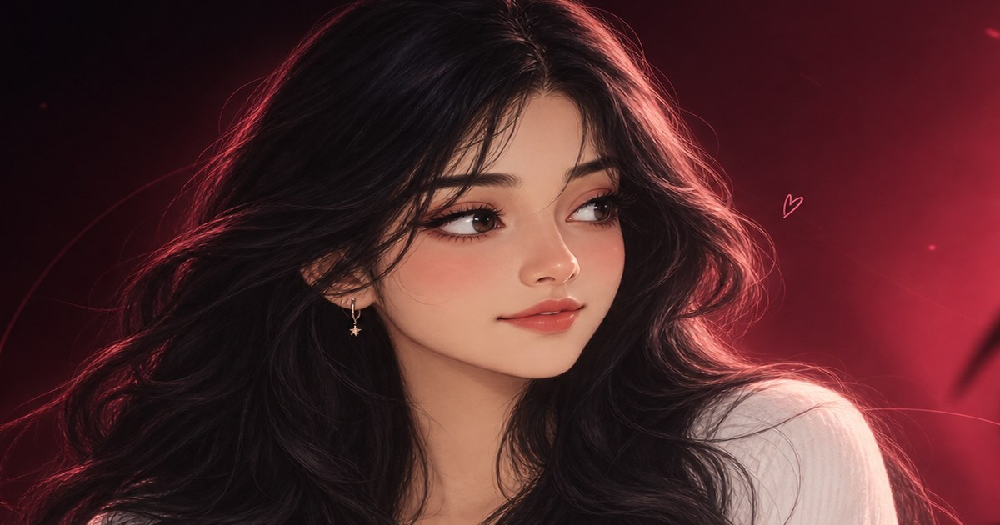

# ✦ Lavanya R — Personal Portfolio

<p align="center">
  
</p>

<h3 align="center">
  A personal space where creativity meets technology. ✨
</h3>

<p align="center">
  Designed and developed by me to showcase my journey,
  technical skills, and projects in software development and AI.
</p>

<p align="center">
  
  
  
  
</p>

---

## 🌸 About the Project

This is my personal portfolio website, created to introduce myself, showcase my technical abilities, and present the projects I have worked on as an Artificial Intelligence and Data Science student.

I wanted to build something that feels personal rather than follow a conventional portfolio template. I combined a modern interface, a distinctive anime-inspired character, subtle animations, and carefully designed sections to create a portfolio that reflects my personality and interest in technology.

From the visual experience to the content structure, I developed this project to bring my ideas to life and create a professional space to share my work.

**This portfolio represents my approach to learning, experimenting, designing, and building with technology.**

---

## ✨ Highlights

🎨 **Personalized Visual Design**
- A distinctive anime-inspired hero section featuring my character artwork.
- A carefully designed dark aesthetic with vibrant lighting and visual details.
- Consistent colours, typography, and layouts throughout the website.

🌊 **Smooth Interactions & Animations**
- Subtle portrait movement and layered parallax effects.
- Scroll-triggered section animations.
- Interactive navigation and custom visual elements.
- Reduced-motion support for a more accessible experience.

💻 **About Me**
- Personal introduction and professional interests.
- Educational background and technical journey.
- Skills, experience, and certifications.

🚀 **Projects Showcase**
- Dedicated sections for my projects.
- Technology details and project descriptions.
- Repository and live-demo links where available.
- Custom project previews created with HTML and CSS.

📄 **Resume & Contact**
- Resume buttons appear when the resume PDF is available.
- Contact section for professional communication.
- A structured presentation of my professional profile.

📱 **Responsive Experience**
- Designed to provide a consistent experience across supported screen sizes.
- Interactive effects adapt to different input devices.
- Motion preferences are respected.

---

## 🛠️ Tech Stack

| Technology | Purpose |
|---|---|
| React | Building reusable UI components |
| TypeScript | Type-safe application development |
| Vite | Development server and production builds |
| HTML5 | Structuring the website |
| CSS3 | Styling, animations, and responsive layouts |
| Python | Processing the character artwork |
| Git & GitHub | Version control and project hosting |

---

## 🎭 A Design Detail I Care About

The anime-inspired character is an important part of my portfolio's visual identity.

Instead of treating it as a static decoration, I incorporated subtle movement and layered visual effects to make the hero section feel more dynamic.

The original artwork is preserved separately, while processed versions are used for the website.

Because the character artwork is a single illustration, the eyes are not independently animated. Instead, the portrait uses subtle movement and parallax effects to create a sense of interaction without distorting the original artwork.

I also considered reduced-motion preferences to make the experience more comfortable for visitors.

---

## 📂 Project Structure

```text
lavanya-portfolio/
│
├── public/
│   ├── img/
│   ├── favicon.svg
│   ├── og-image.jpg
│   └── Lavanya_R_Resume.pdf
│
├── original-assets/
│   └── lavanya-anime-original.png
│
├── scripts/
│   └── process-image.py
│
├── src/
│   ├── components/
│   ├── data/
│   ├── hooks/
│   ├── styles/
│   └── ...
│
├── index.html
├── package.json
├── vite.config.ts
└── README.md